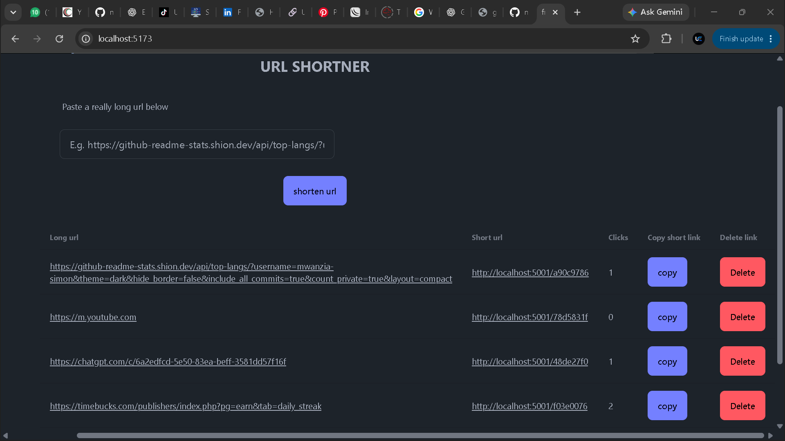

# URL Shortener 

A full-stack URL Shortener application that converts long, complex URLs into short, easy-to-share links. Built to explore backend development, API design, database integration, and URL redirection.



##  Features

- **Short URL Generation:** Convert long URLs into compact, shareable links.
- **URL Redirection:** Automatically redirect users to the original destination.
- **Unique Short Codes:** Generate unique identifiers for shortened URLs.
- **Database Integration:** Store and retrieve URL records.
- **RESTful API:** Handle URL creation and redirection through API endpoints.

##  Tech Stack

Update this section to match the technologies used in your implementation.

- **Frontend:** React, HTML, CSS, JavaScript
- **Backend:** Node.js, Express.js
- **Database:** MongoDB
- **Tools:** Git, GitHub, Postman

##  Project Structure

```text
URL-SHORTENER/
│
├── client/             # Frontend application
│
├── server/             # Backend application
│   ├── config/         # Database configuration
│   ├── controllers/    # Request handlers
│   ├── models/         # Database models
│   ├── routes/         # API routes
│   └── server.js       # Server entry point
│
├── .gitignore
├── README.md
└── package.json
```

##  Installation & Setup

### 1. Clone the repository

```bash
git clone https://github.com/mwanzia-simon/URL-SHORTNER
```

### 2. Navigate into the project

```bash
cd URL-SHORTENER
```

### 3. Install dependencies

Install the backend and frontend dependencies:

```bash
cd server
npm install

cd ../client
npm install
```

### 4. Configure environment variables

Create a `.env` file in the server directory:

```env
PORT=5000
MONGODB_URI=your_mongodb_connection_string
```

Add any additional environment variables required by your implementation.

### 5. Run the application

Start the backend and frontend in separate terminals using their respective development scripts:

```bash
npm run dev
```

##  Learning Objectives

This project is part of my journey in full-stack development. It focuses on:

- Understanding REST API development.
- Working with MongoDB and database operations.
- Implementing URL shortening algorithms.
- Understanding HTTP redirects and status codes.
- Connecting frontend applications to backend services.
- Handling server-side validation and errors.

##  Future Improvements

- User authentication and personalized dashboards.
- URL click analytics and tracking.
- Custom short URLs.
- QR code generation.
- URL expiration functionality.

##  Author

**Simon**

GitHub: [mwanzia-simon](https://github.com/mwanzia-simon)

---

⭐ If you find this project interesting, consider giving it a star!

**Built with curiosity, consistency, and a passion for learning.**